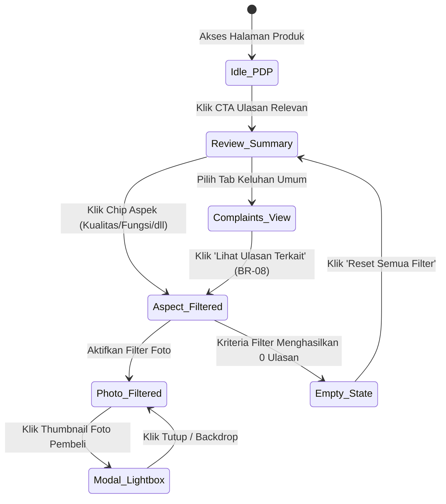

# INTERACTION SPECIFICATION (INTERACTION)
## Micro-Interactions, State Transitions, & Feedback Loops
**Fitur:** Ulasan Relevan – Tokopedia  
**Standar UX:** Feedback Responsif, State Predictability, Direct Manipulation  

---

## 1. State Model Antarmuka

Antarmuka fitur Ulasan Relevan memiliki 5 keadaan sistem (*System States*) yang terdokumentasi:

---

## 2. Detail Spesifikasi Interaksi Mikro

### 2.1 Interaksi Filter Chip (FR-01 & FR-02)
- **Trigger:** Klik / Tap pada chip kategori aspek (*Kualitas, Fungsi, Kesesuaian, Pengiriman*).
- **Feedback Visual (<50ms):**
  - Chip yang dipilih langsung berubah dari warna abu-abu ke hijau Tokopedia `#00AA5B` dengan teks putih tebal.
  - Teks counter ulasan terfilter berganti secara instan (misal: *"Menampilkan 742 ulasan"*).
  - Tampil tombol *"Reset Filter ↺"* warna merah jika filter aktif bukan kategori default.
- **Affordance Sentuh:** Minimal tinggi chip $36\text{ px}$ dengan radius sudut $9999\text{ px}$ (*pill shape*).

### 2.2 Transisi Tab Navigasi Ulasan (Progressive Disclosure)
- **Tabs:** `Daftar Ulasan` | `Ringkasan Pros/Cons` | `Keluhan Sering Muncul`
- **Animasi:** Garis indikator bawah (*underline border*) bergerak halus dengan transisi CSS `transition: all 200ms ease-in-out`.
- **Prinsip UX:** Mencegah perpindahan halaman penuh (*full page reload*) sehingga pengguna tetap berada dalam konteks produk yang sedang dievaluasi.

### 2.3 Interaksi Foto Pembeli & Lightbox Modal (FR-05)
- **Thumbnail Interaction:**
  - Hover: Zoom halus ($105\%$ scale) dengan overlay transparan dan ikon *Expand*.
  - Click: Membuka modal pop-up dengan animasi `fade-in` berdurasi $150\text{ ms}$.
- **Modal Control:**
  - Tombol silang `✕` besar di pojok kanan atas.
  - Klik di luar area modal (*backdrop click*) menutup modal seketika (*user freedom, Nielsen Heuristic #3*).

### 2.4 Interaksi Empty State Recovery (AC-08 & BR-04)
- **Kondisi:** Pengguna memfilter aspek dan foto yang tidak memiliki kombinasi data ulasan.
- **Tampilan:**
  - Ilustrasi icon pencarian netral.
  - Pesan jelas: *"Ulasan Tidak Ditemukan"*.
  - Penjelasan alasan: *"Tidak ada ulasan dengan aspek [Nama Aspek] yang menyertakan foto"*.
  - Tindakan Pemulihan Primer (*Error Recovery*): Tombol hijau besar *"Hapus Filter & Tampilkan Semua"*.

### 2.5 Interaksi Switcher Mode (Hi-Fi Prototype vs Lo-Fi Wireframe)
- Menyediakan kontrol instan di bar kontrol atas.
- Memungkinkan penguji atau dosen membandingkan tampilan prototipe visual interaktif penuh dengan blueprint struktur *low-fidelity* hitam putih tanpa memutus alur yang sedang diuji.
