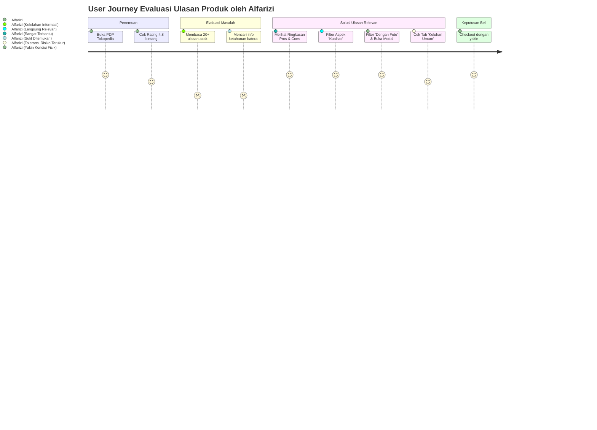

# UX SPECIFICATION (UX-SPEC)
## Fitur: Ulasan Relevan – Tokopedia
**Mata Kuliah:** Rekayasa Interaksi (UX)  
**Tugas:** Worksheet 12 – Wireframe and Prototype  
**Pendekatan:** UX-Driven & Human-Centered Design (Eksperimen B)  

---

## 1. User Research Synthesis & Persona Profile

### 1.1 Persona: Muhammad Alfarizi Hardiansyah
- **Demografi:** 21 Tahun, Mahasiswa S1 Teknik/Informatika, Pengguna Aktif Tokopedia.
- **Tingkat Literasi Digital:** Tinggi (*tech-savvy*), kritis terhadap review berbayar/palsu.
- **Skenario Penggunaan:** Alfarizi ingin membeli *earbuds wireless TWS* seharga Rp 400 ribuan untuk kuliah daring dan mendengarkan musik saat belajar. Anggarannya terbatas, sehingga ia tidak ingin salah beli (*zero room for regret*).
- **Frustrasi Utama:**
  1. Terlalu banyak ulasan bintang 5 singkat ("bagus", "cepat sampai") yang tidak memberi info tentang kualitas suara atau fitting di telinga.
  2. Susah mencari tahu apakah ulasan negatif tentang *"kabel pendek"* atau *"ANC tembus"* dialami oleh banyak orang atau hanya keluhan subjektif 1 orang.
  3. Butuh melihat foto nyata dari pembeli untuk memastikan apakah case earbud terlihat murahan atau kokoh.



---

## 2. Mental Model & Cognitive Load Optimization

### 2.1 Pola Mental Model Pembeli E-Commerce
Pengguna tidak membaca ulasan secara linear dari halaman 1 sampai 10. Pola mental model evaluasi ulasan adalah:
1. **Anchor (Jangkar):** Berapa rating rata-rata? Apakah mayoritas puas?
2. **Triangulasi Negatif:** Apa kelemahan produk ini? Apakah kelemahan itu dapat saya toleransi?
3. **Verifikasi Bukti Riil:** Apakah foto pembeli cocok dengan gambar penjual?
4. **Validasi Aspek Prioritas:** Bagaimana baterainya? Bagaimana suaranya?

### 2.2 Prinsip UX Pengurangan Beban Kognitif (*Cognitive Load*)
- **Progressive Disclosure:** Tampilkan ringkasan eksekutif terlebih dahulu (*Pros/Cons summary*). Jika pengguna ingin mendalami, berikan akses satu-klik ke ulasan aslinya.
- **Recognition over Recall (Nielsen Heuristic #6):** Menggunakan chip filter yang terlihat jelas di atas daftar ulasan, bukan menu tersembunyi di dalam dropdown yang dalam.
- **Affordance & Feedback:** Memberikan visual feedback seketika (highlight warna hijau Tokopedia `#00AA5B`, tag terverifikasi, dan counter jumlah ulasan terfilter).

---

## 3. Information Architecture (IA) & Struktur Navigasi

```
[ Product Detail Page (PDP) ]
  └── [ Section Teaser Ulasan Relevan ]
        └── [ Tombol CTA: Buka Ulasan Relevan ]
              │
              ├── [ Tab 1: Ringkasan Pros/Cons (FR-03) ]
              │     ├── Kartu Kelebihan Utama (Pros) + Sentimen %
              │     └── Kartu Kekurangan (Cons) + Mention Rate %
              │
              ├── [ Tab 2: Filter Aspek & Ulasan (FR-01, FR-02) ]
              │     ├── Chip Aspek: Semua | Kualitas | Fungsi | Kesesuaian | Pengiriman
              │     ├── Toggle: Hanya Ulasan dengan Foto (FR-05)
              │     └── List Ulasan Pembeli Terverifikasi
              │
              ├── [ Tab 3: Keluhan Sering Muncul (FR-04) ]
              │     ├── Kartu Topik Keluhan Berulang + Severity Badge
              │     ├── Dampak Masalah & Saran/Solusi Tokopedia
              │     └── Tautan ke Ulasan Sumber Terkait (BR-08)
              │
              └── [ Modal Lightbox Foto Pembeli (FR-05) ]
                    ├── Preview Foto Resolusi Tinggi
                    ├── Keterangan Foto Fisik Produk
                    └── Ulasan Pembeli Terkait
```

---

## 4. Screen Inventory (5 Layar Terhubung)

1. **Layar 1 (PDP Entry Point):** Menyajikan foto produk, varian, harga diskon, rating, dan banner pemicu ulasan relevan.
2. **Layar 2 (Ringkasan Kelebihan & Kekurangan):** Sintesis ulasan positif dan negatif dengan metrik kepuasan.
3. **Layar 3 (Filter Aspek Aktif):** Penyaringan berdasarkan kualitas fisik, fungsi, kesesuaian deskripsi, atau pengiriman.
4. **Layar 4 (Filter Foto & Modal Lightbox):** Tampilan ulasan berfoto dan pop-up inspeksi foto barang asli.
5. **Layar 5 (Keluhan Umum & Empty State):** Deteksi masalah berulang serta antarmuka penanganan ketika filter tidak memiliki hasil.
