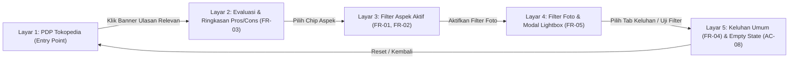

# DOKUMENTASI WIREFRAME & STRUKTUR INFORMASI (UX-DRIVEN)
## Fitur: Ulasan Relevan – Tokopedia
**Mata Kuliah:** Rekayasa Interaksi (UX)  
**Tugas:** Worksheet 12 – Wireframe and Prototype  
**Persona Pengguna:** Muhammad Alfarizi Hardiansyah (21 tahun, Mahasiswa)  

---

## 📌 Ringkasan 5 Layar Wireframe Terhubung

Rancangan wireframe ini menerjemahkan kebutuhan pengguna dan *User Flow* evaluasi produk menjadi antarmuka struktural (*low-fidelity*) yang menghubungkan minimal 5 layar:



---

## 📐 Blueprint Struktur Informasi & Komponen Per Layar

### 1. LAYAR 1 – Product Detail Page (PDP) Tokopedia
*Tujuan Layar:* Memberikan informasi dasar produk dan menyediakan pintu masuk (*entry point*) yang jelas menuju fitur Ulasan Relevan.

```text
+-------------------------------------------------------+
| [<]  [ Search: TWS ANC Bluetooth... ]     [Bell] [Cart]|
+-------------------------------------------------------+
|  Dikirim ke: Kost Mahasiswa Alfarizi, Jakarta Selatan |
+-------------------------------------------------------+
|                                                       |
|              [  AREA FOTO PRODUK  ]                   |
|                   [ X - Box ]                         |
|                                                       |
|                                         1/3 Foto  [♥] |
+-------------------------------------------------------+
| [Official Store] Jakarta Pusat                        |
| SoundPulse ANC Pro Wireless Earbuds - Hi-Res Audio    |
| Rp 489.000  (Rp 750.000) [-35%]                       |
| ★ 4.8 | 2.890 Terjual | 98% Pembeli Puas              |
+-------------------------------------------------------+
| Varian Warna: [ Midnight Black ] [ Frost White ]      |
+-------------------------------------------------------+
| ===================================================== |
| [✦ FITUR BARU: ULASAN RELEVAN TOKOPEDIA]              |
| Evaluasi kualitas & fungsi produk lebih cepat!        |
| [✓ Ringkasan Kelebihan/Kekurangan] [✓ Filter Aspek]   |
| [ >>> TOMBOL CTA: Buka Ulasan Relevan & Rangkuman <<<]|
| ===================================================== |
+-------------------------------------------------------+
| Ulasan Pembeli (1.248)                   Lihat Semua >|
| [★ 4.8 / 5.0] [===== Progress Bar Rating =====]       |
+-------------------------------------------------------+
| [ + Keranjang ]                [ Beli Langsung ]      |
+-------------------------------------------------------+
```

---

### 2. LAYAR 2 – Layar Evaluasi & Ringkasan Pros/Cons (FR-03)
*Tujuan Layar:* Menyajikan sintesis ringkasan kelebihan (*pros*) dan kekurangan (*cons*) secara transparan dari 1.248 ulasan pembeli tanpa bias.

```text
+-------------------------------------------------------+
| [< Kembali]  Detail Produk / Ulasan Relevan           |
+-------------------------------------------------------+
| [Daftar Ulasan]  [*Ringkasan Pros/Cons]  [Keluhan]    |
+-------------------------------------------------------+
| [✦] RINGKASAN CERDAS ULASAN (FR-03)                   |
| Otomatis dirangkum dari 1.248 ulasan terverifikasi    |
|                                                       |
| +---------------------------------------------------+ |
| | [✓] KELEBIHAN UTAMA PRODUK                        | |
| | - Suara Jernih & Bass Solid  [92% Puas]           | |
| |   Aspek: Kualitas  | [Lihat ulasan sumber >]      | |
| | - Baterai Awet 7+ Jam        [88% Puas]           | |
| |   Aspek: Fungsi    | [Lihat ulasan sumber >]      | |
| +---------------------------------------------------+ |
|                                                       |
| +---------------------------------------------------+ |
| | [!] PERLU DIPERTIMBANGKAN (KEKURANGAN)            | |
| | - ANC Kurang Kedap di Keramaian  [17% ulasan]     | |
| |   Aspek: Fungsi    | [Lihat ulasan sumber >]      | |
| | - Kabel Charger Bawaan Pendek    [14% ulasan]     | |
| |   Aspek: Kesesuaian| [Lihat ulasan sumber >]      | |
| +---------------------------------------------------+ |
+-------------------------------------------------------+
| Filter: [ Semua ] [ Kualitas ] [ Fungsi ] ...         |
| [ ( ) Hanya Ulasan dengan Foto ]                      |
+-------------------------------------------------------+
| [Daftar Ulasan Asli Pembeli...]                       |
+-------------------------------------------------------+
```

---

### 3. LAYAR 3 – Filter Aspek Ulasan Aktif (FR-01, FR-02)
*Tujuan Layar:* Mempersempit ulasan hanya pada dimensi produk yang ingin dievaluasi pengguna.

```text
+-------------------------------------------------------+
| Filter Aspek Produk (FR-01):          [Reset Filter ↺]|
+-------------------------------------------------------+
| [Semua] [ *KUALITAS (742)* ] [Fungsi] [Kesesuaian] ...|
+-------------------------------------------------------+
| [ ( ) Hanya Ulasan dengan Foto ]  Menampilkan: 742 uls|
+-------------------------------------------------------+
| +---------------------------------------------------+ |
| | [Avatar] Budi Santoso [✓ Terverifikasi]    ★★★★★  | |
| | 12 Nov 2026 • Varian: Midnight Black              | |
| | [Aspek: Kualitas] [Aspek: Fungsi]                 | |
| | "Sangat puas dengan suaranya! Bass-nya empuk dan  | |
| | vokal sangat detail. Desainnya elegan & kokoh..." | |
| | [👍 Membantu (42)]                    [ Laporkan ]| |
| +---------------------------------------------------+ |
| +---------------------------------------------------+ |
| | [Avatar] Alfarizi [✓ Terverifikasi]        ★★★★☆  | |
| | 08 Nov 2026 • Varian: Midnight Black              | |
| | [Aspek: Kualitas]                                 | |
| | "Build quality juara untuk harga 400 ribuan..."   | |
| +---------------------------------------------------+ |
+-------------------------------------------------------+
```

---

### 4. LAYAR 4 – Filter Foto & Modal Lightbox (FR-05)
*Tujuan Layar:* Membantu pengguna membandingkan kondisi riil fisik barang kiriman dengan foto etalase toko.

```text
+-------------------------------------------------------+
| Filter: [Semua] [Kualitas] ...                        |
| [ [✓] HANYA ULASAN DENGAN FOTO (ACTIVE) ]             |
+-------------------------------------------------------+
| Galeri Foto Pembeli:                                  |
| [Foto 1: Box]  [Foto 2: Case]  [Foto 3: Unit]         |
+-------------------------------------------------------+
|                                                       |
|   =================================================   |
|   || MODAL LIGHTBOX FOTO PEMBELI (POP-UP ZOOM)   ||   |
|   ||---------------------------------------------||   |
|   || Foto Pembeli: Budi Santoso              [X] ||   |
|   ||                                             ||   |
|   ||           +---------------------+           ||   |
|   ||           |                     |           ||   |
|   ||           |  PREVIEW FOTO BESAR |           ||   |
|   ||           |      [ X - Box ]    |           ||   |
|   ||           +---------------------+           ||   |
|   ||                                             ||   |
|   || Keterangan: "Tampilan fisik boks & earbuds" ||   |
|   || "Sesuai banget sama deskripsi toko..."      ||   |
|   || [ >>> Tutup Foto <<< ]                      ||   |
|   =================================================   |
|                                                       |
+-------------------------------------------------------+
```

---

### 5. LAYAR 5 – Keluhan Umum (FR-04) & Penanganan Empty State (AC-08)
*Tujuan Layar:* Memetakan keluhan berulang agar pembeli dapat mengukur toleransi risiko dan menyediakan penanganan kosong yang ramah.

```text
+-------------------------------------------------------+
| [Daftar Ulasan]  [Ringkasan]  [*KELUHAN UMUM (3)*]    |
+-------------------------------------------------------+
| [!] IDENTIFIKASI KELUHAN BERULANG (FR-04)             |
|                                                       |
| +---------------------------------------------------+ |
| | [RINGAN]                                          | |
| | Kabel Charger Bawaan Terlalu Pendek  [18 Pembeli] | |
| | Dampak: Harus menaruh boks dekat sumber listrik.  | |
| | 💡 Solusi: Gunakan kabel Type-C ponsel standar.   | |
| | [Periksa ulasan asli pembeli terkait (BR-08) >]   | |
| +---------------------------------------------------+ |
|                                                       |
| [ Tombol: Uji Kondisi Sistem Tanpa Hasil (AC-08) ]    |
|                                                       |
| ===================================================== |
| [ 🔍 KONDISI FILTER KOSONG (EMPTY STATE) ]            |
| "Ulasan Tidak Ditemukan"                              |
| Tidak ada ulasan yang cocok dengan kriteria filter.   |
| [ >>> Hapus Filter & Tampilkan Semua <<< ]            |
| ===================================================== |
+-------------------------------------------------------+
```
